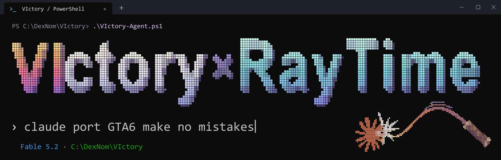

<h1 align="center">DexNom RayTime</h1>

An AMD Radeon–focused Xbox Series compatibility runtime for Windows.

  

  <a href="https://github.com/DexNom/VIctory/archive/refs/heads/main.zip">Download source</a> ·
  <a href="docs/README.md">Documentation</a> ·
  <a href="BENCHMARK.md">Benchmarks</a>

## Get started

Use Windows x64 and a Direct3D 12 GPU with mesh shader and Shader Model 6.6
support. Install the build tools, extract the source ZIP, and run
`Setup.cmd`. Setup builds the runtime locally and asks for the Xbox Series X
executable from your own extracted game installation. [Installation guide](docs/installation.md)

## Compatibility

The tested Radeon profile uses ray tracing and FSR 4.1.2 Quality to upscale
1440p to 4K. [Graphics modes](docs/graphics.md) · [Test results](BENCHMARK.md)

> [!NOTE]
> Warm Chapter 1 City samples ran at about 1.1–1.3 FPS on an RX 7900 XTX.
> Some materials still rendered black. NVIDIA profiles are experimental.

## Contributing

Current priorities are GPU readback, texture memory use, and frame-time
stability. [Contributing guide](docs/CONTRIBUTING.md)

## License and credits

DexNom RayTime builds on Marvisak's VIctory and Radeon work from the
victory-world contributors. [GPL-3.0-or-later](LICENSE) · [Credits and asset policy](docs/README.md#credits)
